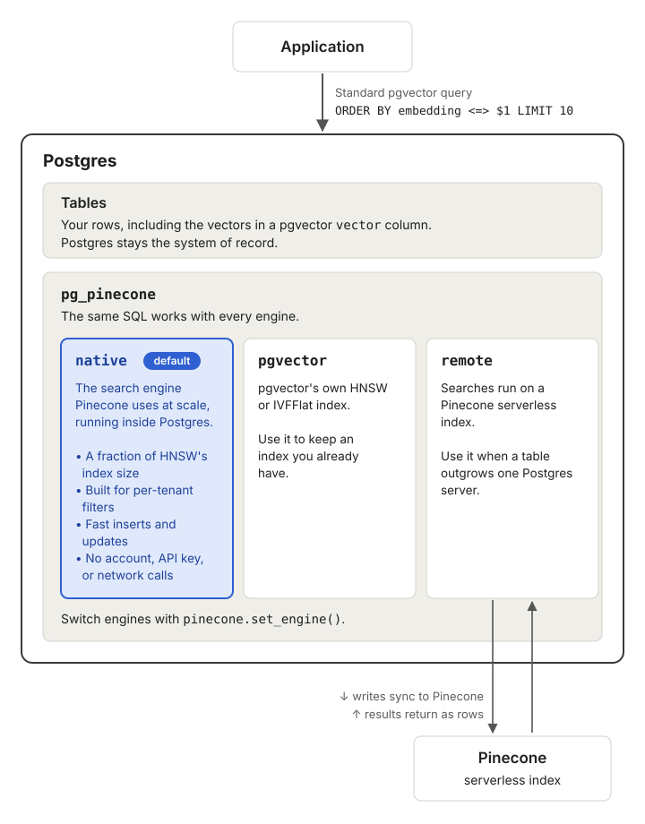

# pg_pinecone

[](https://github.com/pinecone-io/pg_pinecone/actions/workflows/ci.yml)
[](LICENSE)

An open-source PostgreSQL extension that brings Pinecone's vector search into the Postgres
database you already run. Keep your tables and your pgvector queries, and choose an engine per
table.

- **Three engines behind one index**: `pgvector`, `native` (the default), and `remote`. Switch a
  table between them without changing a query.
- **Filtered search inside Postgres**: the `native` engine applies a filter such as a tenant ID
  during the search, with no account or network access.
- **Scale out when you need to**: the `remote` engine moves a table's search to a Pinecone
  serverless index, and Postgres keeps every row.
- **Full-text search**: keep a Pinecone index for full-text search in sync with a table and run
  BM25, vector, or hybrid searches from SQL.
- **pgvector compatible**: index existing `vector` columns as they are.

## How it works

<picture>
  <source media="(prefers-color-scheme: dark)" srcset="docs/images/pg-pinecone-overview-dark.svg">
  
</picture>

## Engines

| Engine | Where the search runs | Use it for |
|---|---|---|
| `pgvector` | pgvector's own HNSW or IVFFlat index, in Postgres | Tables that already have a pgvector index and don't filter |
| `native` (default) | The search engine Pinecone uses at scale, in Postgres | Filtered and unfiltered search, with a small index and no network calls |
| `remote` | A Pinecone serverless index | A table that has outgrown one Postgres server |

Every switch can be reversed. The [pg_pinecone docs][docs] cover how the engines compare and how
to switch between them.

## Quickstart

**Requirements:** PostgreSQL 17 or 18, superuser access, and [pgvector][pgvector] installed on the
server.

Install it one of three ways:

- **Prebuilt release**: download the archive for your platform and Postgres version from the
  [releases page](https://github.com/pinecone-io/pg_pinecone/releases) and copy its files into your
  Postgres installation, as step 1 of the [quickstart][quickstart] shows.
- **Docker**: [`pinecone/pg_pinecone`](https://hub.docker.com/r/pinecone/pg_pinecone) is the
  [`pgvector/pgvector`](https://hub.docker.com/r/pgvector/pgvector) image with `pg_pinecone` added,
  one tag per Postgres major: `docker run -d -e POSTGRES_PASSWORD=secret pinecone/pg_pinecone:0.10.1-pg17`
  (add `-c shared_preload_libraries=pg_pinecone` for the `remote` engine).
- **pgxman**: `pgxman install pg_pinecone`.

Then create the extensions and index a vector column:

```sql
CREATE EXTENSION vector;
CREATE EXTENSION pg_pinecone;

CREATE TABLE items (id bigint PRIMARY KEY, embedding vector(3));
INSERT INTO items VALUES (1, '[1,2,3]'), (2, '[4,5,6]'), (3, '[7,8,9]');

-- Builds a native index. No API key or network access needed.
SELECT pinecone.create_index('items', 'embedding');

SELECT id FROM items ORDER BY embedding <=> '[1,2,4]' LIMIT 2;
```

For a full walkthrough on a sample table, including semantic search with embeddings, see the
[quickstart in the pg_pinecone docs][quickstart].

## Build from source

pg_pinecone is built with [pgrx](https://github.com/pgcentralfoundation/pgrx). You need a Rust
toolchain and the headers of the Postgres you're building for (`pg_config` on your `PATH`, or
pass its path to `--pg-config`).

```bash
git clone https://github.com/pinecone-io/pg_pinecone.git
cd pg_pinecone/pg_pinecone
cargo install cargo-pgrx --version 0.19.2 --locked
cargo pgrx init --pg17 "$(which pg_config)"   # use --pg18 for PostgreSQL 18
cargo pgrx install --release                  # builds and installs into that Postgres
```

`cargo pgrx install` writes the extension into the Postgres `pg_config` points at; then
`CREATE EXTENSION vector; CREATE EXTENSION pg_pinecone;` as above. On x86_64 the build targets your
own CPU, so it runs anywhere you build it. For running the tests, see [CONTRIBUTING.md](CONTRIBUTING.md).

## Documentation

The [pg_pinecone docs][docs] on docs.pinecone.io cover installation, the storage engines,
switching engines, and full-text search.

In this repository:

- [SQL reference](docs/reference.md): every function, setting, and error message
- [Operator runbook](docs/runbook.md): monitoring, upgrades, and maintenance
- [Disaster recovery](docs/disaster-recovery.md): restoring a `remote` table
- [Changelog](CHANGELOG.md)

## Support

- **Questions and feedback**: the [Pinecone Discord community](https://discord.gg/tJ8V62S3sH)
- **Bugs and feature requests**: [GitHub issues](https://github.com/pinecone-io/pg_pinecone/issues)
- **Security issues**: see [SECURITY.md](SECURITY.md)

## Contributing

Start with an issue. See [CONTRIBUTING.md](CONTRIBUTING.md) for how proposals and pull requests
work.

## License

[Apache License 2.0](LICENSE)

<!-- Links -->
[pgvector]: https://github.com/pgvector/pgvector
[docs]: https://docs.pinecone.io/guides/pg-pinecone/overview
[quickstart]: https://docs.pinecone.io/guides/pg-pinecone/quickstart
